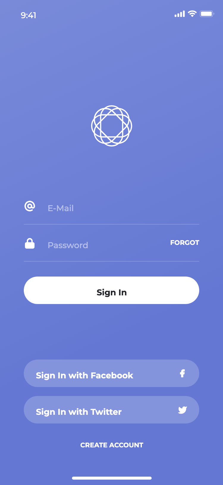
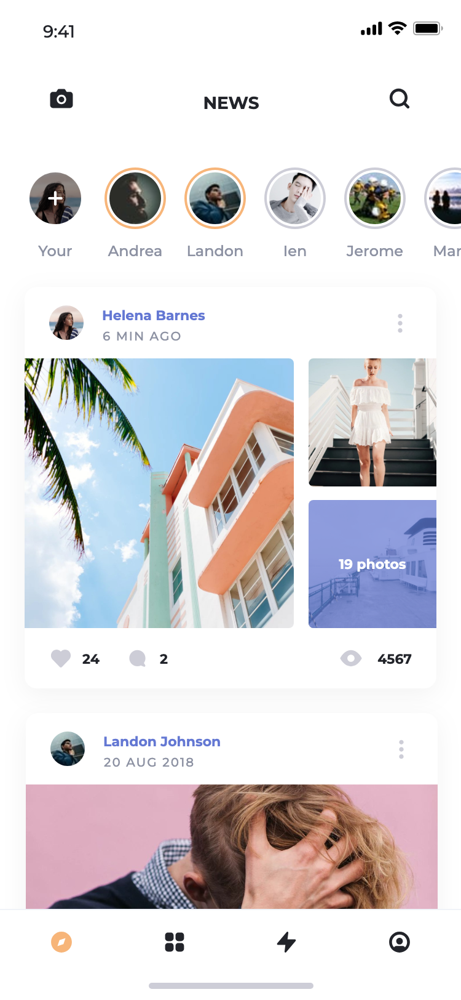
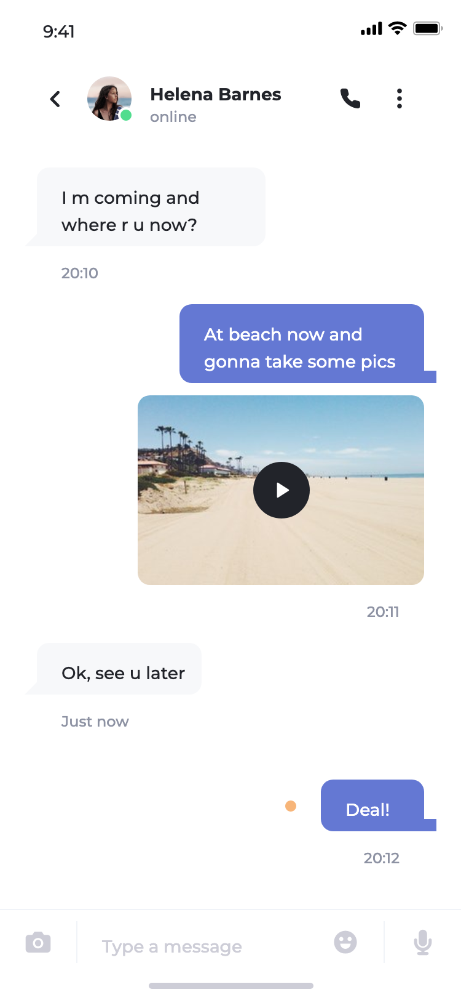
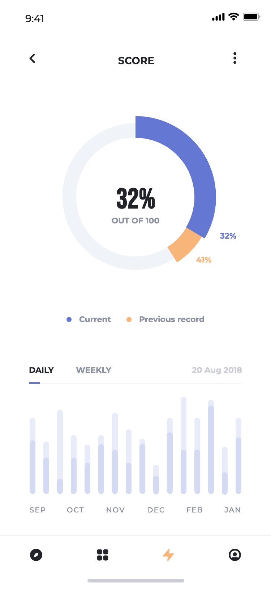
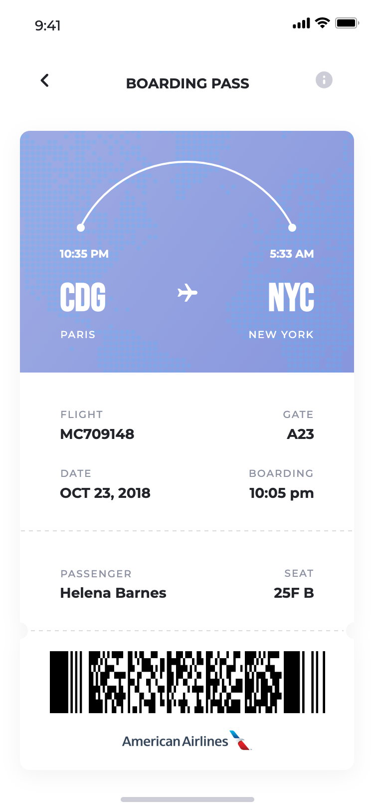

# Think Flutter App

根据 Pixso **Think UI Kit** 实现的 Flutter 界面与本地交互演示。已读取原文件的全部页面分类，保留 **11 个分类、120 个界面**；Style Guide 和 Symbols 用于还原样式与组件，不计入业务界面数量。

项目包含可运行源码、Android 安装包、架构说明、120 张 Flutter 界面截图、11 张分类总览，以及 Android 模拟器主要流程截图。

## 主要界面

以下图片来自本项目运行的 Flutter 界面。完整图片可点击查看。

| 登录 | 动态 |
|---|---|
|  |  |
| 聊天 | 商城 |
|  |  |
| 统计 | 登机牌 |
|  |  |

## 页面覆盖

| Pixso 分类 | 数量 | 内容 |
|---|---:|---|
| 01 Walkthrough | 13 | Splash、12 个引导变体 |
| 02 Sign In & Sign Up | 9 | 登录、注册、手机号、Face ID、找回密码、密码键盘 |
| 03 Social | 12 | 联系人、收件箱、好友、关注、通知、聊天、群聊、机器人、通话 |
| 04 Navigation | 10 | 邮件、财务、社交、旅行、任务与侧栏导航 |
| 05 Profile | 9 | 个人主页、图片墙、资料与关注变体 |
| 06 Feed & News | 11 | 3 个动态列表、帖子、发布页、6 个文章变体 |
| 07 Media | 11 | 歌曲、歌单、播放器、相机、视频、滤镜、直播 |
| 08 Statistics & Data | 12 | 数据图表、步数、钱包、日历、日程、待办 |
| 09 E-commerce | 14 | 商城首页、商品、分类、筛选、评论、搜索、购物车、支付 |
| 10 Travel | 10 | 旅行列表、详情、搜索、机票、地图、路线、登机牌、通知设置 |
| 11 Popups | 9 | 成功、错误、套餐、身份验证、更新、评分、订阅、支付与祝贺 |
| **合计** | **120** | [查看全部界面与节点对应关系](docs/screenshots/README.md) |

## 运行

开发验证环境：Flutter **3.41.6**、Dart **3.11.4**。

```bash
flutter pub get
flutter run -d chrome
# 或连接 Android 设备 / 启动 Android 模拟器后：
flutter run -d emulator-5554
```

Android ARM64 本地测试安装包（商店发布需配置正式签名）：[`dist/think-android-arm64.apk`](dist/think-android-arm64.apk)。Web 发布构建位于 `build/web/`。iOS 与 macOS 工程也包含在源码中；本次移动端运行验证使用 Android 模拟器。

```bash
flutter build apk --release --target-platform android-arm64
flutter build web --release
```

默认进入界面目录，可按分类或英文页面名搜索。选择卡片进入原设计界面。长按空白处、点按左上角边缘，或使用 `⌘K` / `Alt+Home` 返回目录；Android 返回键可返回上一页。界面空白处横向滑动可查看同分类的前后变体；商品与故事列表支持横向滚动。

## 已接通的本地交互

- 邮箱与密码校验、注册资料输入、手机号和六位密码键盘演示；可用任意格式有效的邮箱和至少 6 位密码体验登录。
- 动态与商品跳转、收藏/点赞、关注状态、原生聊天输入与发送。
- 商品尺码选择、加入预置购物车、数量调整、移除、总价计算、结算与支付成功跳转。经购物车进入支付时，按钮金额与结算金额一致。
- 待办勾选、新增任务、通知开关；收藏、关注/开关、购物车数量、消息、任务与显示姓名保存在本机。
- 播放/暂停与进度拖动、菜单导航、旅行列表→详情→搜索→机票→登机牌的浏览流程。
- 搜索目录、原生弹窗、复制页面名称及部分标签选中状态。

这是 **UI 与本地状态演示**：登录不验证服务器账户，支付不会扣款；第三方登录、邮件、真实生物识别、实时聊天/通话、音乐流、摄像头与在线地图尚未接入。相机、地图和图表使用设计中的预置内容，周期标签只切换选中状态。密码与支付卡号不持久化。

## 项目结构与架构

```text
lib/
├── main.dart                         # 启动、资源加载与失败重试
├── app.dart                          # 主题、路由、快捷键
├── core/
│   ├── design/
│   │   ├── design_catalog.dart        # 不可变页面模型与离线图片加载
│   │   └── design_painter.dart        # 矢量、蒙版、文字、渐变、阴影渲染
│   └── state/app_state.dart           # 本地状态、购物车计算与持久化
└── features/
    ├── catalog/catalog_page.dart     # 分类目录、搜索、界面缩略预览
    └── scene/
        ├── scene_controls.dart       # 设计组件→交互控件的语义映射
        └── scene_page.dart           # 页面分层、原生输入/开关、交互与滚动
assets/
├── catalog/think.json                 # 120 页去重后的设计数据
├── design/                           # 82 张本地照片/图片资源
├── branding/                         # Pixso 原始 Logo 与平台图标准备素材
└── fonts/                            # 字体与 OFL 授权文本
docs/
├── ARCHITECTURE.md                    # 架构、渲染方式与扩展约定
├── TESTING.md                         # 验证环境、结果与复现命令
├── design/raw/                       # 只读 Pixso 原始节点归档
└── screenshots/                      # 120 页截图、分类总览、模拟器截图
test/                                # 全量渲染与关键交互测试
integration_test/                     # Android 端到端流程
test_driver/                          # 模拟器截图落盘驱动
tool/                                # 设计数据编译、截图总览生成
```

设计数据与行为分离：共享 `DesignPainter` 根据真实节点绘制界面；`ScenePage` 叠加原生 `TextField`、开关、滑块与带语义的点击区域；`AppState` 管理跨页状态。没有用整页截图作为界面背景，也没有为 120 个页面复制 120 份布局代码。原始导出中不完整的图标已通过原始矢量和蒙版还原。

数据去重后共用 **905 份样式、411 组矢量路径、82 张图片**；图片资源约 **5 MB**。照片已压缩，原始节点数据已归档压缩，临时导出代码与重复资源已清理。界面以原稿 **375 × 812** 坐标等比显示，宽屏会保留比例；不同版本字体的字形与平台抗锯齿可能产生细微差异。

详见 [架构说明](docs/ARCHITECTURE.md)、[测试记录](docs/TESTING.md)、[全量截图索引](docs/screenshots/README.md)。

## 验证与截图复现

```bash
flutter analyze
flutter test
flutter drive --driver test_driver/integration_driver.dart \
  --target integration_test/app_test.dart -d emulator-5554
```

`flutter test` 同时重新生成 `docs/screenshots/` 下的 120 张 PNG 和节点清单。分类总览需要 Python 与 Pillow：

```bash
python3 -m pip install Pillow
python3 tool/build_screenshot_index.py
```

设计数据归档可离线重新编译，无需连接 Pixso：

```bash
python3 tool/compile_design.py
```

素材来自用户提供的 Pixso 文件；字体附带各自的 OFL 授权文本。应用运行时不依赖 Pixso、本地导出服务或外部图片 URL。
