# 全部界面截图

截图来自实际 Flutter Widget 渲染，尺寸为 750 × 1624（设计尺寸 375 × 812，2×）。

Android 模拟器流程截图见 [测试记录](../TESTING.md)。

## 引导与启动 / 01 Walkthrough

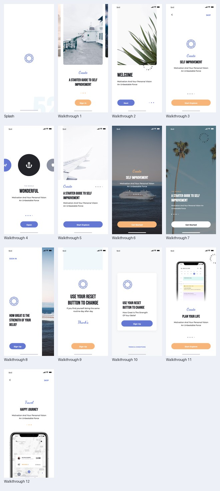

| 界面 | Pixso 节点 | Flutter 截图 |
|---|---|---|
| Splash | `0:204` | [查看](01-splash.png) |
| Walkthrough 1 | `0:190` | [查看](01-walkthrough-1.png) |
| Walkthrough 2 | `0:176` | [查看](01-walkthrough-2.png) |
| Walkthrough 3 | `0:158` | [查看](01-walkthrough-3.png) |
| Walkthrough 4 | `0:135` | [查看](01-walkthrough-4.png) |
| Walkthrough 5 | `0:118` | [查看](01-walkthrough-5.png) |
| Walkthrough 6 | `0:102` | [查看](01-walkthrough-6.png) |
| Walkthrough 7 | `0:85` | [查看](01-walkthrough-7.png) |
| Walkthrough 8 | `0:76` | [查看](01-walkthrough-8.png) |
| Walkthrough 9 | `0:51` | [查看](01-walkthrough-9.png) |
| Walkthrough 10 | `0:40` | [查看](01-walkthrough-10.png) |
| Walkthrough 11 | `0:19` | [查看](01-walkthrough-11.png) |
| Walkthrough 12 | `0:2` | [查看](01-walkthrough-12.png) |

## 登录与注册 / 02 Sign In & Sign Up

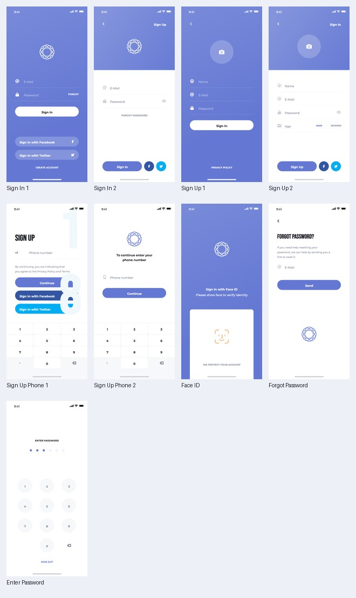

| 界面 | Pixso 节点 | Flutter 截图 |
|---|---|---|
| Sign In 1 | `0:386` | [查看](02-sign-in-1.png) |
| Sign In 2 | `0:366` | [查看](02-sign-in-2.png) |
| Sign Up 1 | `0:336` | [查看](02-sign-up-1.png) |
| Sign Up 2 | `0:309` | [查看](02-sign-up-2.png) |
| Sign Up Phone 1 | `0:284` | [查看](02-sign-up-phone-1.png) |
| Sign Up Phone 2 | `0:274` | [查看](02-sign-up-phone-2.png) |
| Face ID | `0:254` | [查看](02-face-id.png) |
| Forgot Password | `0:244` | [查看](02-forgot-password.png) |
| Enter Password | `0:210` | [查看](02-enter-password.png) |

## 社交与聊天 / 03 Social

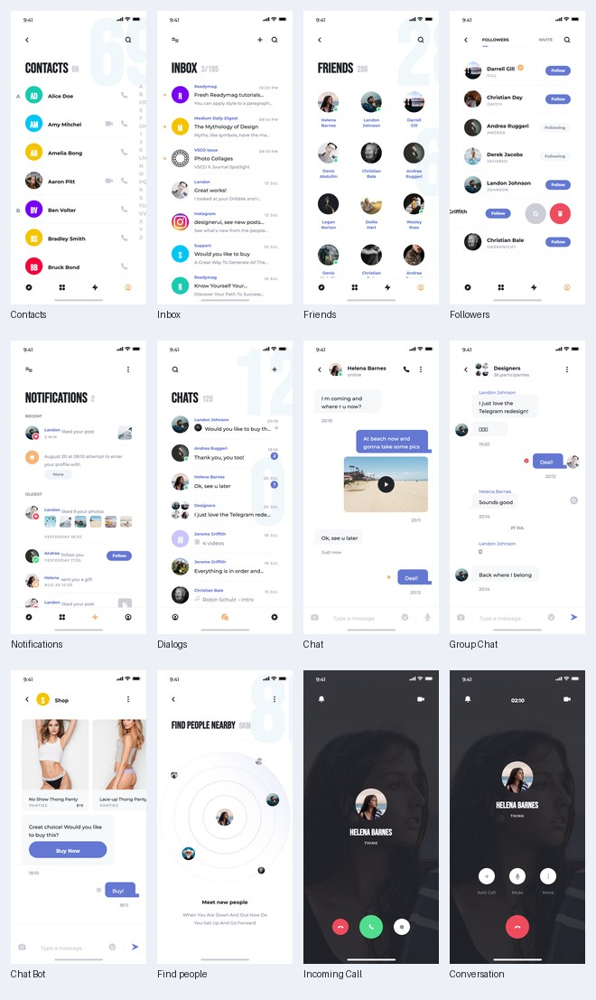

| 界面 | Pixso 节点 | Flutter 截图 |
|---|---|---|
| Contacts | `0:1058` | [查看](03-contacts.png) |
| Inbox | `0:984` | [查看](03-inbox.png) |
| Friends | `0:898` | [查看](03-friends.png) |
| Followers | `0:826` | [查看](03-followers.png) |
| Notifications | `0:732` | [查看](03-notifications.png) |
| Dialogs | `0:652` | [查看](03-dialogs.png) |
| Chat | `0:598` | [查看](03-chat.png) |
| Group Chat | `0:530` | [查看](03-group-chat.png) |
| Chat Bot | `0:476` | [查看](03-chat-bot.png) |
| Find people | `0:451` | [查看](03-find-people.png) |
| Incoming Call | `0:438` | [查看](03-incoming-call.png) |
| Conversation | `0:417` | [查看](03-conversation.png) |

## 导航菜单 / 04 Navigation

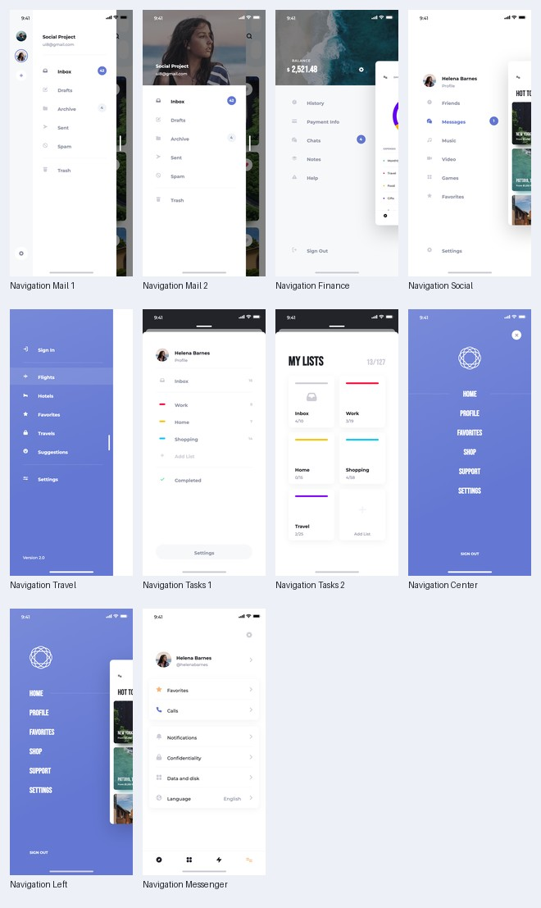

| 界面 | Pixso 节点 | Flutter 截图 |
|---|---|---|
| Navigation Mail 1 | `0:1389` | [查看](04-navigation-mail-1.png) |
| Navigation Mail 2 | `0:1359` | [查看](04-navigation-mail-2.png) |
| Navigation Finance | `0:1329` | [查看](04-navigation-finance.png) |
| Navigation Social | `0:1303` | [查看](04-navigation-social.png) |
| Navigation Travel | `0:1275` | [查看](04-navigation-travel.png) |
| Navigation Tasks 1 | `0:1230` | [查看](04-navigation-tasks-1.png) |
| Navigation Tasks 2 | `0:1190` | [查看](04-navigation-tasks-2.png) |
| Navigation Center | `0:1173` | [查看](04-navigation-center.png) |
| Navigation Left | `0:1156` | [查看](04-navigation-left.png) |
| Navigation Messenger | `0:1130` | [查看](04-navigation-messenger.png) |

## 个人主页 / 05 Profile

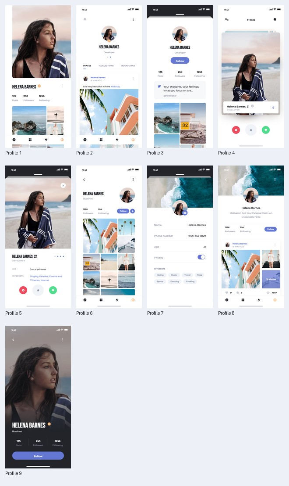

| 界面 | Pixso 节点 | Flutter 截图 |
|---|---|---|
| Profile 1 | `0:1690` | [查看](05-profile-1.png) |
| Profile 2 | `0:1643` | [查看](05-profile-2.png) |
| Profile 3 | `0:1605` | [查看](05-profile-3.png) |
| Profile 4 | `0:1580` | [查看](05-profile-4.png) |
| Profile 5 | `0:1555` | [查看](05-profile-5.png) |
| Profile 6 | `0:1523` | [查看](05-profile-6.png) |
| Profile 7 | `0:1499` | [查看](05-profile-7.png) |
| Profile 8 | `0:1458` | [查看](05-profile-8.png) |
| Profile 9 | `0:1432` | [查看](05-profile-9.png) |

## 动态与文章 / 06 Feed & News

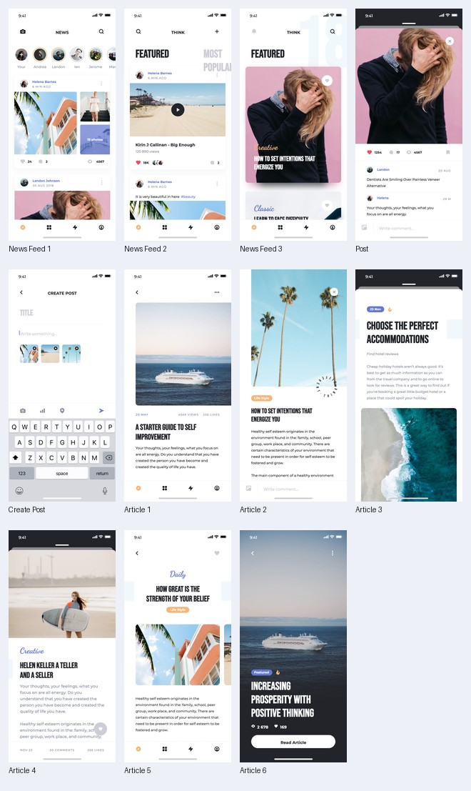

| 界面 | Pixso 节点 | Flutter 截图 |
|---|---|---|
| News Feed 1 | `0:1955` | [查看](06-news-feed-1.png) |
| News Feed 2 | `0:1899` | [查看](06-news-feed-2.png) |
| News Feed 3 | `0:1877` | [查看](06-news-feed-3.png) |
| Post | `0:1837` | [查看](06-post.png) |
| Create Post | `0:1817` | [查看](06-create-post.png) |
| Article 1 | `0:1803` | [查看](06-article-1.png) |
| Article 2 | `0:1786` | [查看](06-article-2.png) |
| Article 3 | `0:1771` | [查看](06-article-3.png) |
| Article 4 | `0:1751` | [查看](06-article-4.png) |
| Article 5 | `0:1733` | [查看](06-article-5.png) |
| Article 6 | `0:1717` | [查看](06-article-6.png) |

## 音乐与影像 / 07 Media

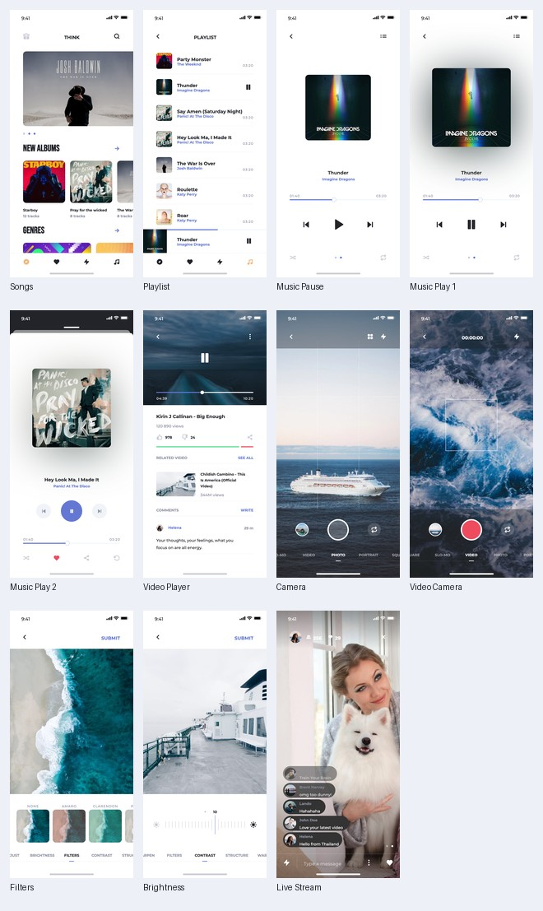

| 界面 | Pixso 节点 | Flutter 截图 |
|---|---|---|
| Songs | `0:2443` | [查看](07-songs.png) |
| Playlist | `0:2378` | [查看](07-playlist.png) |
| Music Pause | `0:2351` | [查看](07-music-pause.png) |
| Music Play 1 | `0:2322` | [查看](07-music-play-1.png) |
| Music Play 2 | `0:2291` | [查看](07-music-play-2.png) |
| Video Player | `0:2238` | [查看](07-video-player.png) |
| Camera | `0:2200` | [查看](07-camera.png) |
| Video Camera | `0:2166` | [查看](07-video-camera.png) |
| Filters | `0:2137` | [查看](07-filters.png) |
| Brightness | `0:2093` | [查看](07-brightness.png) |
| Live Stream | `0:2038` | [查看](07-live-stream.png) |

## 统计与效率 / 08 Statistics & Data

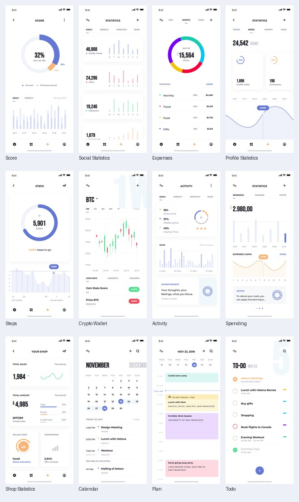

| 界面 | Pixso 节点 | Flutter 截图 |
|---|---|---|
| Score | `0:3410` | [查看](08-score.png) |
| Social Statistics | `0:3303` | [查看](08-social-statistics.png) |
| Expenses | `0:3236` | [查看](08-expenses.png) |
| Profile Statistics | `0:3174` | [查看](08-profile-statistics.png) |
| Steps | `0:3054` | [查看](08-steps.png) |
| Crypto Wallet | `0:2949` | [查看](08-crypto-wallet.png) |
| Activity | `0:2867` | [查看](08-activity.png) |
| Spending | `0:2796` | [查看](08-spending.png) |
| Shop Statistics | `0:2727` | [查看](08-shop-statistics.png) |
| Calendar | `0:2635` | [查看](08-calendar.png) |
| Plan | `0:2549` | [查看](08-plan.png) |
| Todo | `0:2481` | [查看](08-todo.png) |

## 商城与支付 / 09 E-commerce

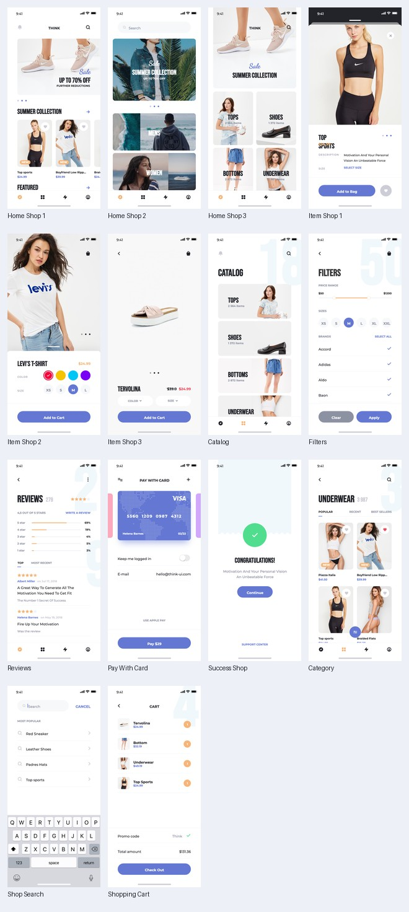

| 界面 | Pixso 节点 | Flutter 截图 |
|---|---|---|
| Home Shop 1 | `0:3975` | [查看](09-home-shop-1.png) |
| Home Shop 2 | `0:3939` | [查看](09-home-shop-2.png) |
| Home Shop 3 | `0:3905` | [查看](09-home-shop-3.png) |
| Item Shop 1 | `0:3879` | [查看](09-item-shop-1.png) |
| Item Shop 2 | `0:3845` | [查看](09-item-shop-2.png) |
| Item Shop 3 | `0:3817` | [查看](09-item-shop-3.png) |
| Catalog | `0:3775` | [查看](09-catalog.png) |
| Filters | `0:3731` | [查看](09-filters.png) |
| Reviews | `0:3650` | [查看](09-reviews.png) |
| Pay With Card | `0:3619` | [查看](09-pay-with-card.png) |
| Success Shop | `0:3592` | [查看](09-success-shop.png) |
| Category | `0:3542` | [查看](09-category.png) |
| Shop Search | `0:3524` | [查看](09-shop-search.png) |
| Shopping Cart | `0:3484` | [查看](09-shopping-cart.png) |

## 旅行与出行 / 10 Travel

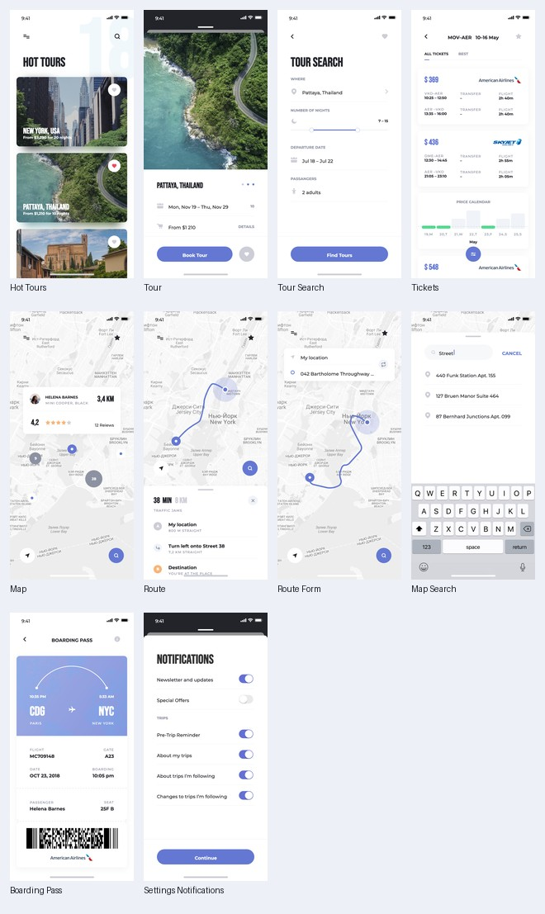

| 界面 | Pixso 节点 | Flutter 截图 |
|---|---|---|
| Hot Tours | `0:4363` | [查看](10-hot-tours.png) |
| Tour | `0:4337` | [查看](10-tour.png) |
| Tour Search | `0:4304` | [查看](10-tour-search.png) |
| Tickets | `0:4219` | [查看](10-tickets.png) |
| Map | `0:4181` | [查看](10-map.png) |
| Route | `0:4134` | [查看](10-route.png) |
| Route Form | `0:4108` | [查看](10-route-form.png) |
| Map Search | `0:4089` | [查看](10-map-search.png) |
| Boarding Pass | `0:4036` | [查看](10-boarding-pass.png) |
| Settings Notifications | `0:4016` | [查看](10-settings-notifications.png) |

## 弹窗与反馈 / 11 Popups

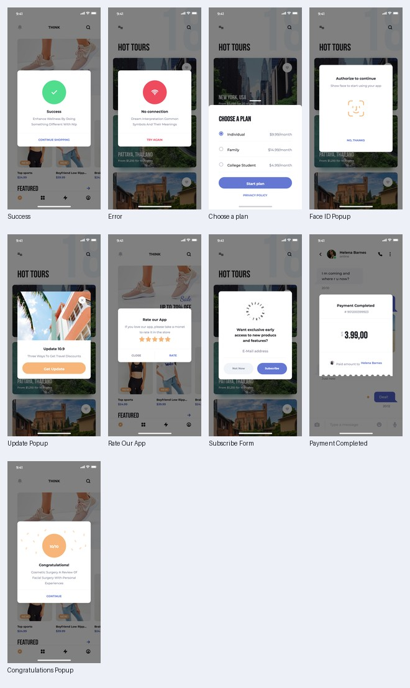

| 界面 | Pixso 节点 | Flutter 截图 |
|---|---|---|
| Success | `0:4560` | [查看](11-success.png) |
| Error | `0:4544` | [查看](11-error.png) |
| Choose a plan | `0:4530` | [查看](11-choose-a-plan.png) |
| Face ID Popup | `0:4511` | [查看](11-face-id-popup.png) |
| Update Popup | `0:4498` | [查看](11-update-popup.png) |
| Rate Our App | `0:4474` | [查看](11-rate-our-app.png) |
| Subscribe Form | `0:4458` | [查看](11-subscribe-form.png) |
| Payment Completed | `0:4426` | [查看](11-payment-completed.png) |
| Congratulations Popup | `0:4395` | [查看](11-congratulations-popup.png) |
